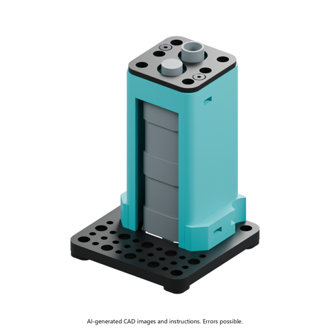

# JT-500 pump holder

Mount a JT-500 submersible pump upright on a 5 × 5 OOBB base with the outlet facing either way. Two ledges support the pump between its rear inlet openings, leaving a water path underneath. The base, clamp and top cover print together as three separate pieces.

Documentation follows [Oomlout's wave-drive assembly book](https://github.com/oomlout/oomlout_oobb_part_motor_gearbox_wave_drive_version_5) and [OOBB conventions](https://github.com/oomlout/oomlout_oobb_version_5), by [Oomlout](https://github.com/oomlout). Pump fit follows the [supplied JT-500 drawing](source_file/pump_dimension_reference.png).

This is an entirely AI-generated coding project. The source code is largely unreadable by humans, but usable generated files are included. It is published so others can use their own AI tools to understand, modify and regenerate the design. Physical pump fit, printed strength and slicing have not been verified.

> AI-generated CAD images and instructions. Errors possible.

## Build

| Image | Version and description | Main README | HTML assembly instructions | PDF download |
| --- | --- | --- | --- | --- |
|  | [**M3 x 16 mm / JT-500**](parts/oobb_holder_motor_pump_submersible_jt_500/README.md) The 6 mm base accepts the pump in either orientation. The cover captures six M6 attachment nuts. | [Design, parts and assembly](parts/oobb_holder_motor_pump_submersible_jt_500/README.md) | [Download offline viewer](parts/oobb_holder_motor_pump_submersible_jt_500/assembly/assembly_instructions.html) | [Download PDF](parts/oobb_holder_motor_pump_submersible_jt_500/assembly/assembly_instructions.pdf) |

[Print all three pieces](parts/oobb_holder_motor_pump_submersible_jt_500/3dpr.stl) · [Follow the six illustrated steps](parts/oobb_holder_motor_pump_submersible_jt_500/README.md#assembly) · [OOBB catalogue](navigation_oobb/README.md)
