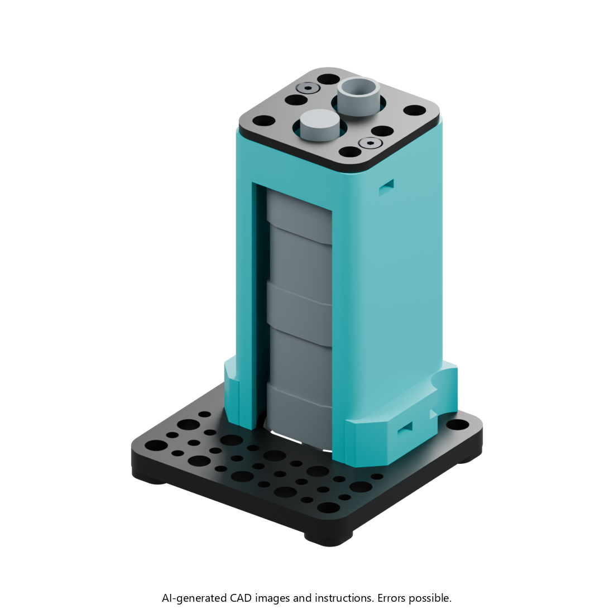
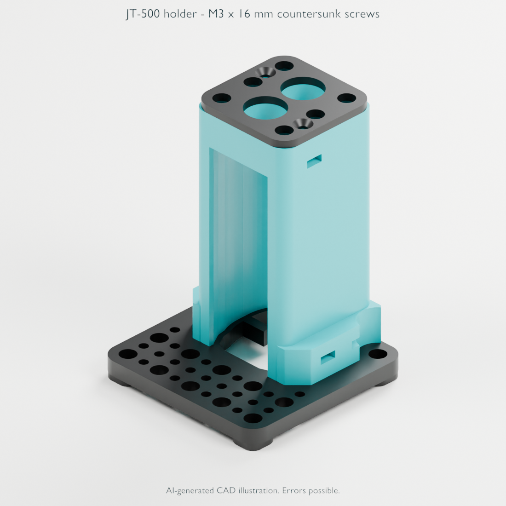
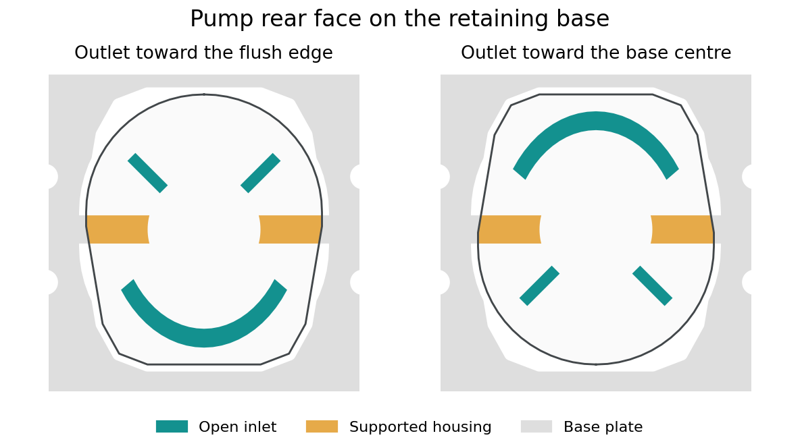
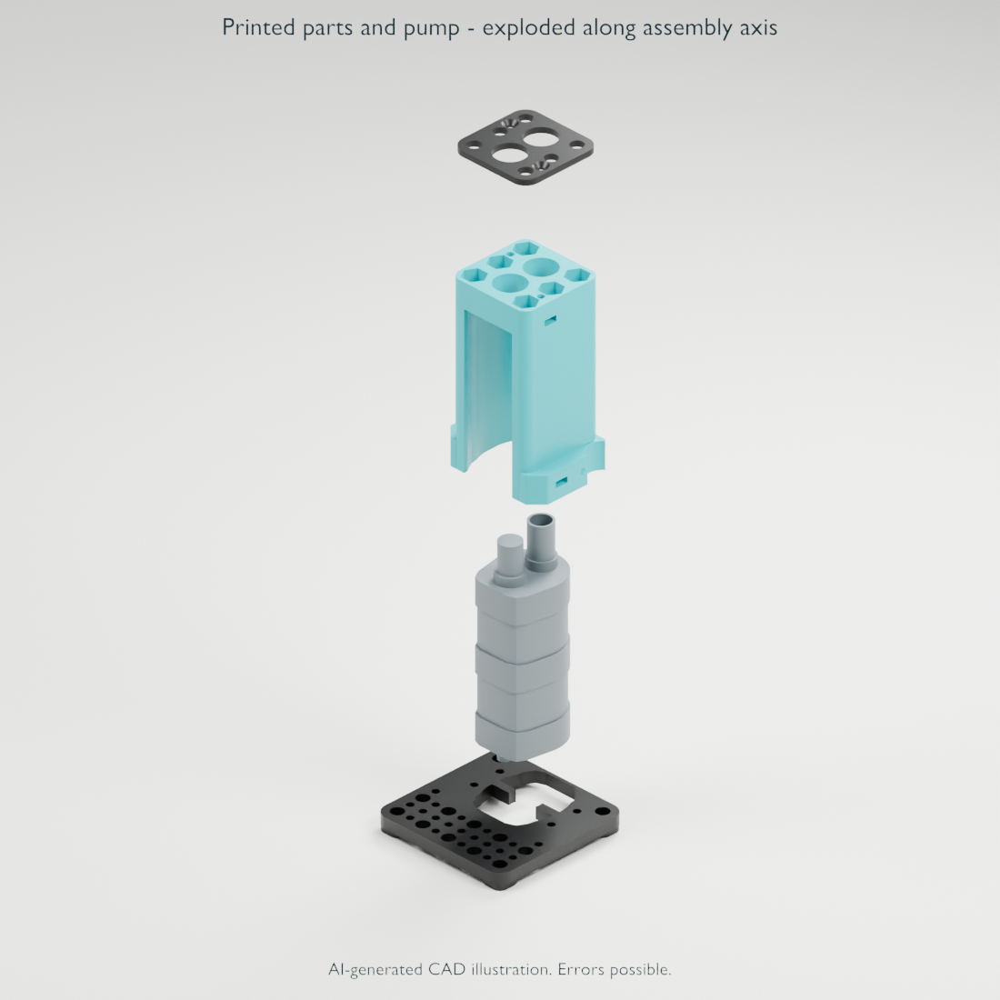
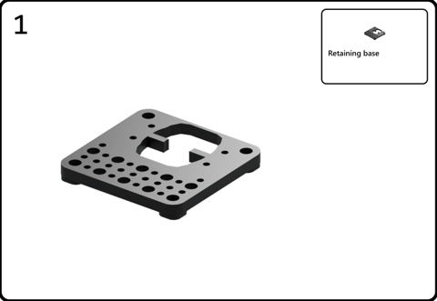
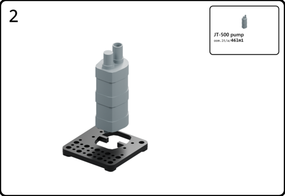
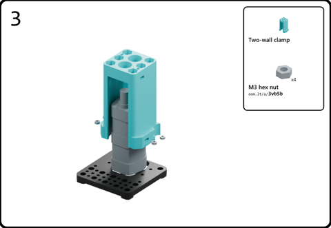
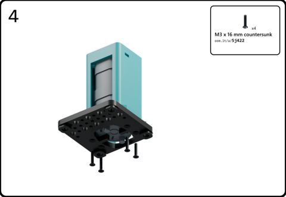
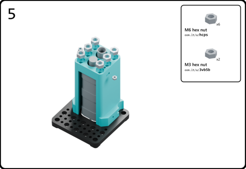
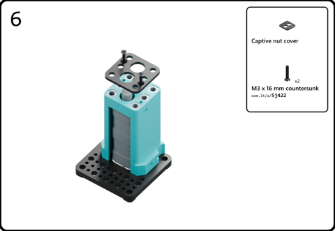

# JT-500 holder - M3 x 16 mm

> AI-generated CAD images and instructions. Errors possible.

## Summary

The retaining base and two-wall clamp capture a JT-500 pump between its rear housing and front face. Four screws enter from the underside and engage nuts loaded into the clamp's side tabs.

This is an entirely AI-generated coding project. The source code is largely unreadable by humans, but usable generated files are included. It is published so others can use their own AI tools to understand, modify and regenerate the design. Physical pump fit, printed strength and slicing have not been verified.

[Project](../../README.md) · [Assembly booklet PDF](assembly/assembly_instructions.pdf) · [Download offline HTML](assembly/assembly_instructions.html) · [Jump to assembly](#assembly)

## Details

Print the [combined STL](3dpr.stl) once. It contains the 6 mm base plate, two-wall clamp and 3 mm cover in their print orientations. The 5 × 5 base measures 74 × 74 mm. [Editable print layout](3dpr.scad) · [Assembled CAD](assembly.scad)

Turn the pump through 180° to choose the outlet side. Each of the two 15.5 mm roof openings can take the outlet or cable. Underneath, the 4 mm wide ledges rest against solid housing between the three inlets. The feet leave 3 mm beneath the fin tips.

The cover captures six M6 nuts on the 15 mm grid. Curved notches in the clamp leave 15 mm diameter clearance around the two M6 base holes at the flush edge.

## Parts

| Hardware for one holder | Quantity | Catalogue identity | OOMP code |
| --- | ---: | --- | --- |
| [M3 x 16 mm countersunk](https://github.com/oomlout/oomp_hardware_screw_version_5/tree/main/parts/hardware_screw_countersunk_hex_head_black_m3_diameter_16_mm_length) | 6 | [hardware_screw_countersunk_hex_head_black_m3_diameter_16_mm_length](https://github.com/oomlout/oomp_hardware_screw_version_5/tree/main/parts/hardware_screw_countersunk_hex_head_black_m3_diameter_16_mm_length) | [5j422](https://oom.lt/a/5j422) |
| [M3 hex nut](https://github.com/oomlout/oomlout_oomp_version_1_messy/tree/main/parts/hardware_nut_m3) | 6 | [hardware_nut_m3](https://github.com/oomlout/oomlout_oomp_version_1_messy/tree/main/parts/hardware_nut_m3) | [3vb5b](https://oom.lt/a/3vb5b) |
| [M6 hex nut](https://github.com/oomlout/oomlout_oomp_version_1_messy/tree/main/parts/hardware_nut_m6) | 6 | [hardware_nut_m6](https://github.com/oomlout/oomlout_oomp_version_1_messy/tree/main/parts/hardware_nut_m6) | [hcps](https://oom.lt/a/hcps) |
| [JT-500 pump](https://github.com/oomlout/oomp_motor_version_5/tree/main/parts/motor_pump_submersible_jt_500) | 1 | [motor_pump_submersible_jt_500](https://github.com/oomlout/oomp_motor_version_5/tree/main/parts/motor_pump_submersible_jt_500) | [46lm1](https://oom.lt/a/46lm1) |

The table covers one complete holder and pump. Hose, electrical connections and fasteners for attaching the base to another structure are outside this inventory. Use ordinary hex nuts and measure countersunk screws including the head.

## Assembly

[Download the offline page viewer](assembly/assembly_instructions.html) · [Download the A4 booklet](assembly/assembly_instructions.pdf)

### Preparation

- Print the single 3dpr.stl once: it contains the base, clamp and top cover, separated by 10 mm on the bed. Keep all three pieces separate. The assembly.scad file shows their fitted positions.
- Keep the supplied STL orientations: base plate face on the bed with feet upward; clamp on its open side with the pump axis horizontal. Inspect the slicer preview before printing.
- Clear the nut slots, screw bores and water openings. Test that each M3 nut slides fully into its pocket.
- Use four M3 x 16 mm countersunk screws for the base and two M3 x 16 mm countersunk screws for the cover. Both lengths include the head; the linked hex-socket screws use a 2 mm hex key.
- Leave the hose disconnected. Route the free cable end through both clamp and cover before fitting them; check that any fitted connector clears the circular openings. Use either roof opening for the outlet and the other for the cable.

### 1. Place the base

Place the base on its four feet, retaining tongues facing upward and the four screw countersinks facing downward.

### 2. Seat the pump

Choose which side you want the outlet on. Lower the pump onto the two ledges with its outlet and cable up. Check from underneath that the fins enter the windows and all three inlet openings are clear.

### 3. Load the nuts and fit the clamp

Slide two M3 nuts into each side of the clamp. Pass the cable through its top opening and lower the clamp over the pump, guiding the outlet through the other opening. Seat both nut tabs against the base.

### 4. Fasten from underneath

Hold the pump and clamp seated while accessing the underside. Insert all four M3 x 16 mm countersunk screws upward into the captive nuts. Start each screw before tightening them evenly until the heads seat; stop when the pump is captured without distorting the printed parts.

### 5. Load the top nuts

Drop six M6 nuts into the upper roof pockets. Slide one M3 nut into each lower side slot beneath the roof shoulders. Seat every nut flat; keep all six M6 bores clear.

### 6. Encapsulate the nuts

Pass the cable through the cover and lower it over the outlet, with the countersinks upward. Insert two M3 x 16 mm countersunk screws downward through the plate into the lower side-loaded M3 nuts and tighten evenly until the cover seats. Keep all six M6 attachment holes clear.

### Installation

- Check that the pump rear face rests on both retaining tongues and that the fins pass into the water openings.
- Confirm that the top plate captures the pump, all nuts are seated, and the cable and outlet are free of pinching.
- Use the exposed OOBB holes to attach the base to your structure. Choose those attachment fasteners for the mating structure; they are not included in the holder hardware count.
- Keep the underside water openings clear when mounting the holder.
- The cover presents six accessible M6 captive attachment nuts. Keep M6 screw projection below the cover face to at most 8 mm; the holes pass through the roof, so check that projecting bolts clear the pump. Attachment screws are not included in the inventory.

### Regeneration

Run `python action_make_holder.py` to rebuild CAD, run geometry checks, render the views and generate these instructions. The source text, part labels and six-step sequence are explicit dictionaries in `working_oomp_populate.py`, carried through `working_oomp.py` and `working_scad.py`. Run `python working_documentation.py --no-render` to recomposite the book from current, matching renders. [Build and validation notes](../../presentation/README.md).
